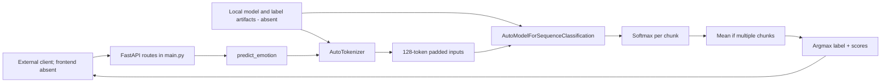
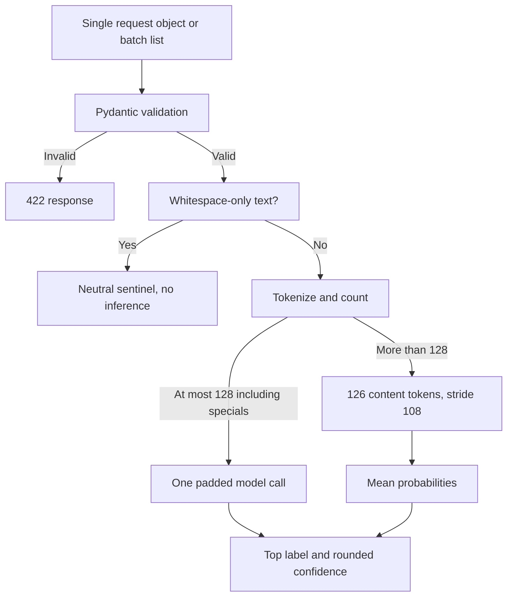
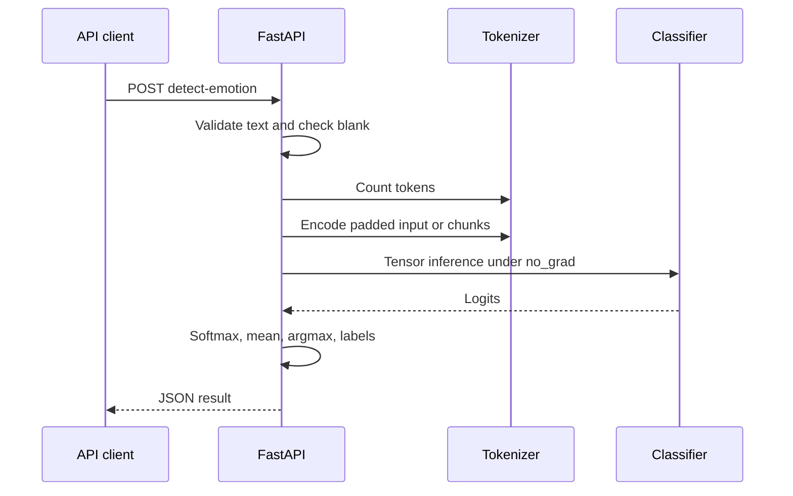
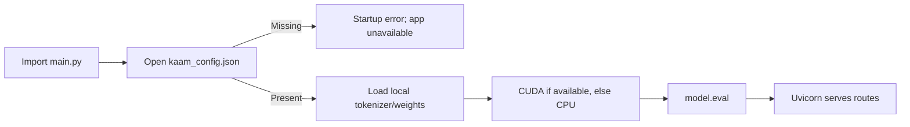

# Architecture: inference service only

No frontend component hierarchy, database ER diagram, authentication flow or chat journey
can be truthfully drawn from this repository. Its data flow is transient text -> tokens ->
tensors -> scores -> response; there is no storage edge. Model loading occurs at import,
not a FastAPI lifespan hook, so missing files prevent even the health endpoint from starting.
